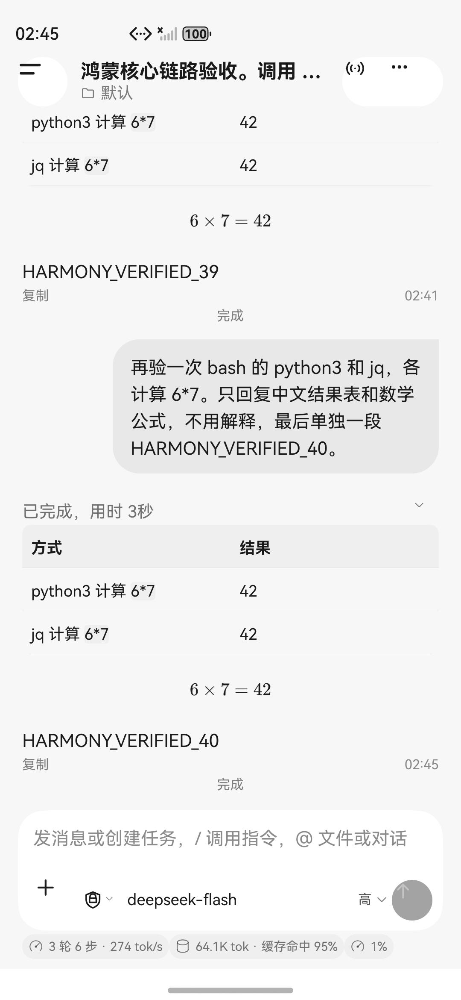

# HarmonyOS emulator verification

The target is the Android phoneDSH product shell on native HarmonyOS. The current
client runs locally in the official HarmonyOS 6 API 20 ARM64 phone emulator. No
Harmony phone was available. Full visual and platform parity is **not certified**.

## Measured behavior

Codex drove the installed HAP using the official DevEco CLI and HDC. The Worker,
HTTP/WS server, shell and storage ran inside the emulator without a Mac server or
port forwarding. Tests used the real production Worker and the pinned DSH source;
no DSH patch or modified shared wire/WAL codec was introduced.

| Flow | Observed result |
| --- | --- |
| Model configuration | Reused the user's authorized existing configuration privately. DeepSeek Messages endpoint, `deepseek-flash`, AssetStore key. Connection test returned 200; a separate invalid-key fixture returned 401 and was removed. |
| Post-turn chrome | Completion publishes before UI folding. Session usage is reread after the final queued turn, rather than retaining startup counters. Known reasoning levels use localized labels. |
| Streaming chat | Exact assistant replies observed in the native transcript, including `HARMONY_CHAT_OK`. Native proxy received actual status 200 before stream data. |
| Tool round trip | Model invoked bash, read a file and ran Python and jq; the assistant returned `TOOLCHAIN_OK`. The product file viewer independently read the tool-written bytes. |
| Stop | Stopped a newly observed running bash task before its delayed write. Worker reported user abort. The sentinel remained absent after its scheduled write time; a later model turn returned `CONTINUE_OK`. |
| Cold conversation recovery | Forced app termination and restarted. The model correctly recalled `ORBIT_6047`. |
| Renderer recovery | The debug build terminated its own ArkWeb renderer through the public controller API. Native failure appeared; retry restored the Worker and a real model reply recalled the same code. |
| File recovery | File→directory and directory→file replacement survived cold restart. A deterministic PNG retained its SHA-256 and decoded through ImageKit. This is process restart evidence, not a power-loss test. |
| Rich content | Native table, fenced code, display and inline RaTeX formula rendered. Binary image preview displayed actual Worker bytes. |
| Session controls | Model catalog, model choice, reasoning level and permission preset were read back from real Worker projections; original choices restored. |
| Providers | Added, selected, tested and removed a temporary invalid-key profile. Restored and retested the original profile. |
| Tool row updates | The same stable tool row changed from running to completed without changing its identity. Expanded transcript confirmed no stale running badge. |
| Session artifacts | A tool-written file remained listed after a later turn with no writes. After force-stop/restart and another turn, an older file still opened with exact bytes `COLD_ARTIFACT_8349`. |
| Composer references | `@` filtered actual workspace files; selecting the file replaced the draft with the relative path. |
| Registered commands | Actual catalog included compact, feedback, goal, permission and plan. `/permission` returned the current preset through commands/execute, including as the first submission in a brand-new session. No invented `/help` entry. |
| Folders | Created and renamed a folder with immediate UI readback, restored the default folder and deleted the fixture. |
| Configuration | Invalid zero was refused. Changed the real agent-loop parallel-tool limit, reopened it to read back the value, then restored and reread the original value. |
| Automation | Created a task scheduled in 2035, changed its title, saved an unchanged draft successfully and deleted it. The task never executed. |
| Preferences | Live English/Chinese chrome remounts without restarting the Worker. Dark/system appearance and three-role font controls use persisted settings. |

Local UI traces, screenshots, failed attempts and JSON proof files are retained
under `.audit/harmony-product/` in the development worktree. Failed harness
assumptions, including selecting a nonexistent help command or incorrect page
IDs, are not counted as product passes.

## Checks

- 72 pure ArkTS/model regressions passed.
- 36 native host tests passed, including real TCP ACK/RESYNC, safe replacement
  replay, duplicate writes and restart behavior.
- Shared spec, cross-tree and Rust wire/WAL gates passed.
- The pinned Worker image pack and no-DSH-patch gate passed.
- The unsigned development HAP built successfully and installed normally. The initial PR candidate is build40. See [PARITY.md](PARITY.md) for subsequent emulator comparisons.
- Aggregate repository CI is **not green**. The unchanged Android baseline has
  hygiene/SPDX findings; the iOS UI catalog has stale source anchors. The plugin
  bridge test expects different accelerator output. macOS WebKit visibility
  tests failed while their window was occluded. The gate-contract test also
  fails on the baseline hygiene findings. Harmony's newly added source files
  have no remaining hygiene or SPDX findings. No gate was skipped to label the
  overall run PASS.

## Remaining differences

- Android Ubuntu/proot, background execution/handoff and physical device links
  are not implemented by this host. Phone permission facts do not imply that
  camera, location or notification hardware was exercised.
- WAL ACK level 1 and process recovery are exercised. Epoch close, manifest/GC
  and level 2/power-loss durability are not certified.
- P04 unified bridge target is not implemented. The paired same-HAP page adapter
  is registered separately and leaves production request/stream frames intact.
- Code syntax highlighting, exact inline text/math wrapping, CJK formula font
  shaping and narrow table presentation still differ from Android.
- Whole-product pixel parity and every error/approval/queue/platform combination
  have not been signed off. The development HAP is usable for further testing;
  it is not a claim of completed Android 1:1 release parity.

An additional read-only automation investigation timed out without a completed verdict and is not counted as a review pass. The focused integration review did complete; its cold artifact metadata, first-command dispatch and final-turn publication findings were corrected and checked on the emulator.

## iPhone branding alignment

The HarmonyOS app and launcher ability now both display **Phone DSH**, matching
`CFBundleDisplayName` in the iPhone Info.plist. Both icon resource scopes reuse
the original iPhone AppIcon-1024.png byte for byte. The official SDK packages a
512-pixel version. A rebuilt HAP was installed and the actual emulator launcher
was inspected for its name and artwork. Bundle identity and stored data remain
unchanged. Protocol impact: P09: none — branding resources only; no UI schema,
wire, ABI or persistence changes.
