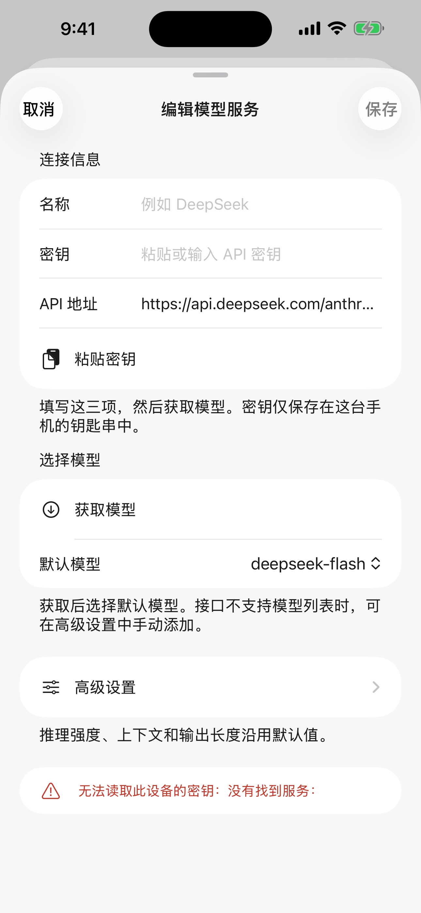
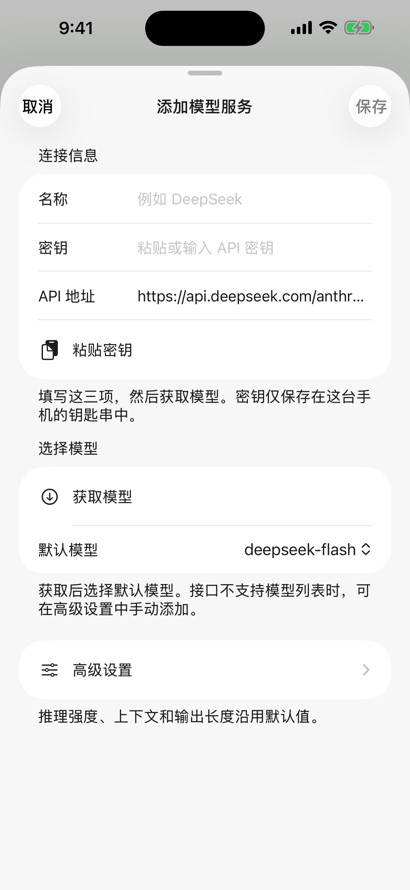

# PR22 follow-up validation

Base: `2695fd21d2d32369c5b3c8b8ae4cc736819b7d74` (merged PR22 and PR18 fixes).

The Add button previously presented an Edit-titled form and queried a credential
for the empty new-profile id. A single sheet item now carries both the profile
and add/edit mode. Cancel/reopen discards the draft.

The workbench toolbar Picker is now extracted, and segmented choices are compared
as actions. Only the proven false `文件` baseline entry was removed (174→173).
The existing real Android gaps remain visible; strict whole-App parity is not claimed.

Validated on iPhone14ProMax/iOS26.5 simulator:

- Three native `ModelProviderEditorUITests`: PASS (first Add; Edit→Add; Cancel→Add).
- Full UI Python suite: 89 PASS.
- All 33 page contracts up to date; page ratchet: 173 known, zero new/stale.
- Token/source checker: PASS with six existing deferred contrast pairs.
- `git diff --check`: PASS.

Reproduce with `xcodebuild test -project examples/probe-app/PhoneDSHProbe.xcodeproj
-scheme PhoneDSHDeviceUI -destination 'platform=iOS Simulator,id=<simulator-id>'
-only-testing:PhoneDSHDeviceUITests/ModelProviderEditorUITests
-parallel-testing-enabled NO CODE_SIGNING_ALLOWED=NO`, after the documented asset
staging and XcodeGen step. Run Python checks from the repository root.

The screenshots compare the title/error state of the production sheet. Before
entered through the product home; after entered through the provider-list preview
route and used its real Add action. No credentials, provider requests or physical
device validation. See `evidence.json` for source/capture hashes and exact scope.

| Before | After |
|---|---|
|  |  |
